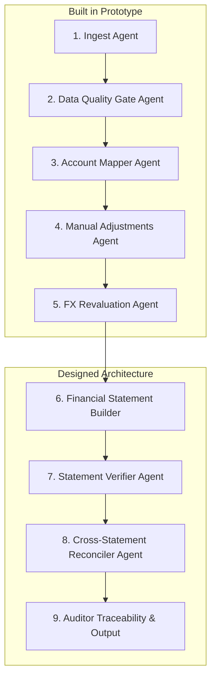
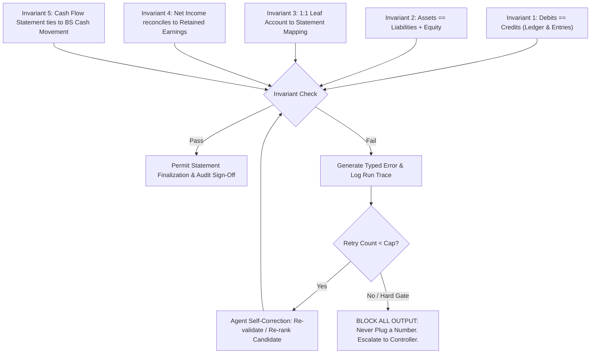

# System Architecture: ERP Financial Reporting Agent

## 1. Executive Summary & Design Philosophy

The **ERP Financial Reporting Agent** is an enterprise-grade financial reporting and adjustments governance architecture designed to ingest, validate, diagnose, reconcile, and report against enterprise ERP general ledger extracts.

Financial reporting workflows require **absolute mathematical correctness, cryptographic auditability, and deterministic accounting enforcement**. In this architecture:
- **No Float Arithmetic:** All monetary amounts are parsed, calculated, and compared strictly as Python `Decimal` instances with fixed scale.
- **LLM Decoupled from Accounting Logic:** Generative AI models are strictly prohibited from determining journal dispositions, modifying ledger balances, inventing account codes, or resolving financial discrepancies. Generative models operate exclusively as advisory candidate rankers (constrained to deterministic candidate sets) and narrative explanation generators.
- **Fail-Closed Verification:** Missing exchange rates, incomplete ledger extracts, or ambiguous currency rows halt execution or quarantine items rather than synthesizing or plugging numbers.
- **Inviolable Hard Integrity Gates:** Fundamental accounting invariants (such as double-entry equality, balance sheet equation, and postable leaf accounts) cannot be bypassed by reviewer overrides.
- **Built vs. Designed Boundary:** This repository implements the **Manual Adjustments Agent & Data Quality Diagnostic Engine** end-to-end as a production-minded working prototype, while providing the complete architectural specification for the full financial statement generation system.

---

## 2. Full System Agent Topology & Pipeline Justification

The full financial reporting system coordinates specialized, single-responsibility agents across an audited pipeline:



### Agent Roles Across the Full System

1. **Ingest Agent (Built):**
   - Ingests raw ERP extracts (`trial_balance.csv`, `chart_of_accounts.csv`, `fx_rates.csv`, `prior_period_tb.csv`, `manual_adjustments.json`).
   - Computes immutable SHA-256 binary digests before decoding.
   - Parses strongly typed Pydantic models with fixed-scale `Decimal` values.

2. **Data Quality Gate Agent (Built):**
   - Validates trial balance completeness, duplicate accounts (e.g. account 6310 split rows), missing COA mappings (e.g. suspense account 9999), and rate completeness.
   - Detects currency semantics ambiguities (e.g. raw gap -$4,800 vs. multi-currency translation gap) and halts downstream automated closing fail-closed when rates are absent (`GBP` closing rate missing).

3. **Account Mapper Agent (Built with LLM Task A):**
   - Evaluates unmapped account references (e.g. account 6315 in JE-005).
   - Generates deterministic top-$K$ candidate postable accounts using lexical and COA hierarchy similarity.
   - Employs a narrow LLM ranking step constrained strictly to valid candidates. Flags candidates that would cause self-offsetting entries. Escalates to human review for approval.

4. **Manual Adjustments Agent (Built):**
   - Validates unposted journal adjustments against inviolable hard gates (balance, postability, period bounds).
   - Enforces order-independent symmetric duplicate handling and balance-sufficiency rules using COA normal balance conventions.
   - Routes non-critical advisories (e.g. self-offsetting lines) to human quarantine.

5. **FX Revaluation Agent (Built):**
   - Re-evaluates monetary asset revaluations against configured ledger balances and official FX rates.
   - Distinguishes currency-basis errors (`JE_CURRENCY_BASIS_INVALID`, hard reject) from arithmetic calculation mismatches (`JE_FX_MISMATCH`, quarantine).

6. **Financial Statement Builder (Designed):**
   - Aggregates post-adjustment trial balance balances into financial statement line items (BS, P&L, Cash Flow, SOCIE) using the COA hierarchy and statement attributes.

7. **Statement Verifier Agent (Designed):**
   - Enforces core accounting invariants: Total Debits == Total Credits, Assets == Liabilities + Equity.
   - Confirms that every active ledger account maps to exactly one financial statement leaf node.

8. **Cross-Statement Reconciler Agent (Designed):**
   - Validates cross-statement mathematical linkages:
     - Net Income from P&L reconciles to the Retained Earnings movement on the Balance Sheet and SOCIE.
     - Net change in cash from Cash Flow Statement equals Balance Sheet cash delta.
     - Depreciation expense in P&L reconciles to Accumulated Depreciation movements.

### Justification: Deterministic Pipeline vs. Narrow LLM Steps
Financial reporting cannot tolerate non-deterministic or probabilistic behavior. A pure LLM pipeline fails because LLMs hallucinate numbers, struggle with exact arithmetic on multi-digit numbers, and lack transaction isolation. Conversely, a purely rule-based pipeline struggles with unstructured memos, ambiguous account names, and generating explanations for audit committees.

Therefore, our architecture implements a **deterministic spine with narrow LLM tasks**:
- **The deterministic spine** guarantees mathematical exactness, transactional state rollbacks, and policy enforcement.
- **Narrow LLM steps** are deployed solely where fuzzy comprehension is needed (e.g. ranking candidate account mappings or synthesizing natural-language explanations for auditors), and their outputs are strictly validated by software contracts before acceptance.

---

## 3. Deterministic vs. LLM Boundary Matrix

| System Component | Responsible Subsystem | Allowed LLM Interaction | Verification & Enforcement |
|---|---|---|---|
| **File Ingestion & Parsing** | Deterministic (`src/ingest.py`) | None | Pydantic validation, SHA-256 hashes |
| **Monetary Arithmetic** | Deterministic (`Decimal`) | Strictly None | Exact integer-scale decimal operations |
| **COA Postability & Rules** | Deterministic (`CoaIndex`) | None | Condition A (Header) & Condition B (Summary Parent) |
| **Double-Entry Balance** | Deterministic (`src/journal.py`) | None | $\sum \text{Debits} == \sum \text{Credits}$ within $\epsilon = 0.00$ |
| **Balance Sufficiency** | Deterministic (`src/journal.py`) | None | Check against COA `normal_balance` & TB balance |
| **FX Revaluation Delta** | Deterministic (`src/journal.py`) | None | $\text{Source Balance} \times (\text{Rate}_{\text{end}} - \text{Rate}_{\text{open}})$ |
| **Unmapped Account Suggestion** | Hybrid (`src/resolver.py` + `src/llm.py`) | LLM ranks top-5 candidate codes | Code validates choice $\in \text{Candidate Set}$ & postable |
| **Audit Narrative Explanations** | Generative (`src/llm.py`) | Explains deterministic context | Explains only; zero disposition mutation authority |
| **Disposition Assignment** | Deterministic (`src/journal.py`, `src/hitl.py`) | Strictly None | Immutable state machine (`ACCEPTED`, `REJECTED`, `QUARANTINED`) |
| **Financial Statement Synthesis** | Deterministic (Designed) | None | Summation of mapped trial balance accounts |
| **Cross-Statement Reconciliations**| Deterministic (Designed) | None | Cryptographic tie-out assertions |

---

## 4. Failure Modes & Mitigations

| Failure Mode | Impact if Unchecked | Architectural Mitigation |
|---|---|---|
| **Hallucinated Mapping** | Adjustment posted to non-existent or inappropriate account | RapidFuzz produces top-5 candidate postable accounts. LLM response is schema-validated: if proposed account is not in candidate list or non-postable, code discards it, logs trace, and escalates to human review. |
| **Unbalanced Journal ($\text{Dr} \ne \text{Cr}$)** | Corrupts trial balance and breaks accounting equation | Inviolable Hard Gate (`JE_UNBALANCED`). Assigned `REJECTED`. Reviewer approval command strictly refuses approval. |
| **Account Fits No COA Node** | Transaction lost or omitted from financial statements | Quarantined with `JE_ACCOUNT_UNMAPPED`. Requires explicit human mapping via `map-account` followed by complete automated revalidation. |
| **Missing FX Rate Gap** | Arbitrary or stale rates distort foreign currency valuation | Fail-Closed Architecture. Emits `DQ_RATE_MISSING` and `DQ_TB_RECONCILIATION_BLOCKED`. Halts automated closing without inventing rates. |
| **Circular Intercompany Postings** | Artificial inflation of intercompany receivables and payables | Symmetrical self-offsetting detector (`JE_SELF_OFFSETTING`). Quarantined for auditor business justification. |
| **Ambiguous Currency Semantics** | Distorts multi-currency cash balances by hundreds of thousands | `DQ_TB_CURRENCY_AMBIGUITY` detects that native translation expands imbalance from -$4.8k to -$338k. Flags both figures and escalates to Controller. |

---

## 5. Validation and Self-Correction Loop with Accounting Invariants

The financial reporting agent enforces five mathematical and structural accounting invariants across all execution stages:



### Invariant Definitions
1. **Debits == Credits ($\sum \text{Dr} - \sum \text{Cr} = 0$):**
   Enforced on every journal entry and on the aggregate adjusted trial balance.
2. **Accounting Equation ($\text{Assets} = \text{Liabilities} + \text{Equity}$):**
   Enforced on the post-closing Balance Sheet.
3. **Exhaustive 1:1 Mapping:**
   Every postable active account in the trial balance must map to exactly one financial statement line item. Zero orphaned accounts.
4. **P&L to Equity Articulation:**
   $\text{Ending Retained Earnings} = \text{Beginning Retained Earnings} + \text{Net Income} - \text{Dividends/Distributions}$.
5. **Cash Flow Articulation:**
   $\Delta \text{Cash on Balance Sheet} = \text{Net Cash Flow from Operating} + \text{Investing} + \text{Financing Activities}$.

### Failure Protocol
- **Typed Diagnostic Response:** Any invariant violation produces a structured, typed diagnostic record (e.g. `JE_UNBALANCED`, `DQ_TB_IMBALANCE_PARTIAL`).
- **Bounded Retry Cap:** For fuzzy resolution steps (such as LLM account mapping ranking), self-correction is capped at 2 attempts.
- **Fail-Closed Block:** If an invariant fails or retry cap is reached, statement publication is **strictly blocked**.
- **Zero Plugging:** The system is architecturally prohibited from creating "plug" accounts, rounding adjustments, or synthetic offset entries.

---

## 6. Auditor Traceability & Drill-Down (Cell to Source SQL)

Every monetary value reported on a generated financial statement is linked to an immutable cryptographic lineage graph connecting:
1. The financial statement line item.
2. The contributing adjusted trial balance accounts.
3. The raw unadjusted trial balance rows.
4. Every accepted manual adjustment journal line contributing to that account.
5. The specific HITL review decisions, reviewer identity, timestamp, and policy fingerprint under which adjustments were approved.
6. The exact FX rates and translation rules applied.

### Concrete Traceability Query Example

Below is the concrete SQLite/PostgreSQL audit query demonstrating cell-to-source traceability for Balance Sheet Line Item `1110` ("Cash and Cash Equivalents"):

```sql
-- Auditor Drill-Down: Trace Balance Sheet Line Item to Raw ERP Source Rows and Manual Adjustments
WITH RawTbCash AS (
    SELECT 
        tb.account_code,
        tb.currency,
        tb.debit AS raw_debit,
        tb.credit AS raw_credit,
        COALESCE(fx.rate, 1.0) AS applied_fx_rate,
        (tb.debit - tb.credit) * COALESCE(fx.rate, 1.0) AS translated_tb_balance
    FROM trial_balance tb
    LEFT JOIN fx_rates fx 
        ON tb.currency = fx.currency 
       AND fx.rate_type = 'period_end'
    WHERE tb.account_code = '1110'
),
AdjustmentsCash AS (
    SELECT 
        adj.id AS entry_id,
        adj.description,
        line.debit AS adj_debit,
        line.credit AS adj_credit,
        (line.debit - line.credit) AS adj_net_impact,
        rev.decision AS hitl_disposition,
        rev.reviewer,
        rev.policy_fingerprint,
        rev.reviewed_at
    FROM manual_adjustments_lines line
    JOIN manual_adjustments adj ON line.entry_id = adj.id
    LEFT JOIN review_store rev ON adj.id = rev.entry_id
    WHERE line.account = '1110'
      AND rev.decision = 'ACCEPTED'
)
SELECT 
    '1110 - Cash and Cash Equivalents' AS statement_line_item,
    (SELECT SUM(translated_tb_balance) FROM RawTbCash) AS unadjusted_tb_total_usd,
    (SELECT SUM(adj_net_impact) FROM AdjustmentsCash) AS approved_adjustments_net_usd,
    (SELECT SUM(translated_tb_balance) FROM RawTbCash) + 
    COALESCE((SELECT SUM(adj_net_impact) FROM AdjustmentsCash), 0.0) AS audited_balance_sheet_value_usd;
```

---

## 7. Idempotency, Cache Verification, and Human Override Governance

1. **Rerun Idempotency:**
   - The engine computes a composite hash of all input file SHA-256 digests and the canonical policy fingerprint.
   - If input files and policies are unchanged, `run_pipeline()` reuses cached decisions and diagnostics without re-computation or duplicate logging.

2. **Policy Invalidation:**
   - Any modification to validation parameters, account rules, or FX policies alters the `policy_fingerprint`.
   - Stale review decisions associated with an older policy fingerprint are automatically invalidated upon subsequent runs, forcing revalidation of quarantined items under the new policy rules.

3. **Human Override Governance:**
   - Human reviewers can map unmapped accounts (`map-account`), reclassify entries (`reclassify-entry`), or approve reviewable advisories (`approve`).
   - Every human action executes inside an atomic ACID transaction. If post-override full revalidation fails or uncovers hard failures, the transaction rolls back completely with zero persistent state mutation.
   - All reviewer decisions record reviewer username, ISO-8601 timestamp, mandatory explanatory notes, and the issue code set presented to the reviewer.

---

## 8. State of Implementation: Built vs. Designed

| Architecture Module | Implementation Status | Shipped Prototype Components |
|---|---|---|
| **Binary Ingestion & Hashing** | **BUILT (100%)** | `src/ingest.py`, SHA-256 digests, Pydantic schemas |
| **COA Hierarchy & Eligibility** | **BUILT (100%)** | `src/ingest.py`, Condition A & B postability checks |
| **Data Quality Diagnostics** | **BUILT (100%)** | `src/dq_checks.py`, multi-currency TB, duplicate detection |
| **Manual Adjustments Validation**| **BUILT (100%)** | `src/journal.py`, hard gates, symmetric deduplication |
| **FX Revaluation Verification** | **BUILT (100%)** | `src/journal.py`, FX contract, basis vs. delta precedence |
| **Pluggable LLM Layer (Mock/Live)**| **BUILT (100%)** | `src/llm.py`, `src/resolver.py`, Task A & B, run trace |
| **HITL Review Store & CLI** | **BUILT (100%)** | `src/store.py`, `src/hitl.py`, `src/cli.py`, SQLite ACID |
| **Audit Trace & Markdown Reporting**| **BUILT (100%)** | `src/audit.py`, `evaluation_report.md`, `issues_report.md` |
| **Financial Statement Builder** | *DESIGNED* | Formally specified; target for post-prototype phase |
| **Statement Verifier & Linkages** | *DESIGNED* | Invariants specified; target for post-prototype phase |
| **Cross-Statement Reconciler** | *DESIGNED* | Articulation logic specified; target for post-prototype phase |

---

## 9. Assumptions and Open Questions for the Controller

Before finalizing statutory financial statements from this ledger extract, the following accounting ambiguities require formal determination by the Financial Controller:

1. **Trial Balance Currency Semantics:**
   - *Issue:* In `data/trial_balance.csv`, raw debits ($71,072,200.00$) and raw credits ($71,077,000.00$) exhibit a naive gap of $-\$4,800.00$. When non-USD cash rows (EUR 825,400.00 and GBP 412,300.00) are translated using closing rates, the debit/credit gap widens to hundreds of thousands of dollars ($-\$338,687.00$ partial gap with EUR alone).
   - *Question for Controller:* Are the foreign currency rows in the ERP extract already stated in functional USD, or are they denominated in local currencies requiring closing translation?

2. **Missing GBP Closing Exchange Rate:**
   - *Issue:* In `data/fx_rates.csv`, the `GBP` closing rate (`period_end`) for `2024-Q4` is absent.
   - *Question for Controller:* What is the certified period-end closing rate for GBP/USD for Q4 2024? (The system currently halts multi-currency reconciliation fail-closed).

3. **Applicable Rate for Journal Adjustment JE-003:**
   - *Issue:* JE-003 records a revaluation gain of $\$11,200.00$ on account 1110 EUR cash. The calculated delta between opening rate ($1.071$) and period-end rate ($1.095$) on EUR 825,400.00 is $+\$19,809.60$.
   - *Question for Controller:* Did the preparer use an alternative intraday/effective rate, or was the $\$11,200.00$ an erroneous calculation requiring adjustment to $\$19,809.60$?

4. **Materiality Tolerance for Raw Trial Balance Imbalance:**
   - *Issue:* The unadjusted trial balance exhibits an unallocated raw gap of $-\$4,800.00$, and account `9999` contains a suspense debit of $\$12,400.00$.
   - *Question for Controller:* Does the organization permit posting an offsetting entry to a designated variance account under a materiality threshold, or must the source subledger be reconciled before closing?

5. **Pre-Closing Retained Earnings and SOCIE Integration:**
   - *Issue:* Account `3200` (`Retained Earnings`) has a credit balance of $\$7,240,000.00$ in the current trial balance while nominal P&L accounts remain open with approximately $\$5.98\text{M}$ in net income.
   - *Question for Controller:* Does the $\$7,240,000.00$ balance represent beginning retained earnings for the quarter, or does it include prior interim closings? How should opening equity articulate into the Statement of Changes in Equity (SOCIE)?
