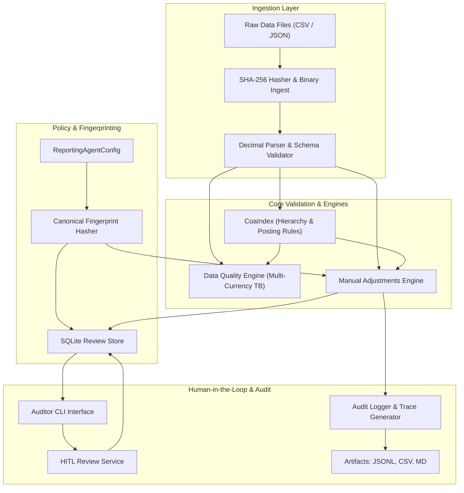

# System Architecture: ERP Financial Reporting Agent

## 1. Executive Summary & Design Philosophy

The **ERP Financial Reporting Agent** is a production-minded prototype designed to ingest, validate, diagnose, and govern unposted financial adjustments against enterprise ERP ledger extracts.

Financial reporting workflows require **absolute mathematical correctness, cryptographic auditability, and deterministic accounting enforcement**. In this architecture:
- **No Float Arithmetic:** All monetary amounts are parsed and manipulated strictly as Python `Decimal` instances with fixed scale.
- **LLM Decoupled from Accounting Logic:** Generative AI models are strictly prohibited from determining journal dispositions, modifying ledger balances, or creating account codes. Narrative explanations are provided via a deterministic mock engine by default (or an optional temperature-0 LLM wrapper).
- **Fail-Closed Verification:** Missing exchange rates, incomplete ledger extractions, and unresolved currency balances halt execution or quarantine items rather than inventing synthetic numbers.
- **Inviolable Hard Gates:** Accounting integrity checks (e.g. debits == credits, postable leaf accounts) cannot be bypassed by reviewer approval commands.

---

## 2. System Architecture & Component Diagram

---

## 3. Subsystem Breakdown

### 3.1 Ingestion & Cryptographic Fingerprinting Layer (`src/ingest.py`)
- Reads raw files in binary mode (`rb`) to calculate immutable SHA-256 hashes prior to string decoding.
- Maps CSV columns to strongly-typed Pydantic schemas, replacing commas and parsing numeric fields into `Decimal`.
- Source files in `data/` are treated as strictly immutable and read-only.

### 3.2 Chart of Accounts Index & Posting Eligibility (`src/ingest.py`, `src/dq_checks.py`)
- Structures accounts into an in-memory parent-child tree.
- Enforces two independent, non-hierarchical structural posting conditions:
  - **Condition A (Explicit Header):** Any account with `account_type == 'Header'` is non-postable (catches Account `1290`).
  - **Condition B (Summary Parent):** Any account with children in the COA is non-postable (catches Account `8000`).
- Prevents journal adjustments from polluting summary reporting lines.

### 3.3 Data Quality & Multi-Currency Engine (`src/dq_checks.py`)
- Segregates data quality diagnostics (`DataQualityFinding`) from journal entry dispositions (`JournalEntryDisposition`).
- Evaluates exchange rate completeness in `data/fx_rates.csv`. Discovers that `GBP` period-end rate is missing for `2024-Q4`.
- Emits `DQ_RATE_MISSING` and blocks full ledger reconciliation fail-closed (`DQ_TB_RECONCILIATION_BLOCKED`).
- Performs partial comparison on USD and EUR accounts, emitting `DQ_TB_IMBALANCE_PARTIAL` ($-\$338,687.00\text{ USD}$) as a non-conclusive diagnostic that never mutates journal entry statuses.

### 3.4 Manual Adjustments Engine (`src/journal.py`)
- **Mechanism A (Rerun Idempotency):** Hashes all input files and policy settings. Reruns with identical hashes return cached results without reprocessing.
- **Mechanism B (Order-Independent In-Batch Duplicate Handling):** Scans the input batch symmetrically; any `entry_id` appearing $\ge 2$ times results in **all** copies being quarantined with `JE_INBATCH_DUPLICATE`.
- **Mechanism C (Cross-Batch Repeat Submission):** Re-encountering an entry ID that was accepted in a prior run flags the entry with reviewable advisory `JE_PRIOR_ACCEPTANCE`.
- **Structured FX Revaluation Contract:**
  - Evaluates accounts matching `{"1110", "7310"}` under `FxRevalPolicy`.
  - Calculates expected delta: $825,400.00\text{ EUR} \times (1.095 - 1.071) = +\$19,809.60\text{ USD}$.
  - Requires Debit to `1110` and Credit to `7310`. Inversion triggers `JE_FX_DIRECTION_INVALID`.
  - Distinguishes suspected currency-basis errors (booking $825,400.00$ into USD lines $\rightarrow$ `JE_CURRENCY_BASIS_INVALID`, `REJECTED`) from arithmetic mismatches (booking $\$11,200.00$ $\rightarrow$ `JE_FX_MISMATCH`, `QUARANTINED`).

### 3.5 HITL Review & Atomic State Management (`src/hitl.py`, `src/store.py`)
- Employs an ACID-compliant SQLite review store with transaction management.
- Hard gates are inviolable: `approve` strictly refuses approval on `REJECTED` entries.
- Account mapping (`map-account`) requires non-empty `--reviewer` and `--notes`, verifies source and target accounts, and executes in-memory revalidation of all hard gates before atomically persisting state changes. On failure, state rolls back with zero mutation.
- Candidate entries can be reclassified to `standard_adjustment` via `reclassify-entry` with required notes, subjecting the entry to standard hard validation.

### 3.6 Dynamic Policy Fingerprinting (`src/config.py`)
- Computes SHA-256 over a canonical JSON serialization of all decision-relevant settings: policy identity, version, `policy_classification`, `functional_currency`, FX policy, COA eligibility rules, hard gates, and approval rules.
- Monitored by `test_policy_fingerprint_exhaustively_covers_all_config_fields()`, which inspects configuration dataclass fields and prevents silent omissions.
- Any setting modification alters the fingerprint and invalidates prior review decisions.

---

## 4. Production Scaling Roadmap

For enterprise deployment at scale:
1. **Ledger Ingestion Pipeline:** Decouple file ingestion via an event-driven worker architecture (e.g. Apache Kafka / Cloud Pub/Sub) feeding worker pods running the validation engine.
2. **Review Store Evolution:** Migrate SQLite review store to distributed PostgreSQL with row-level locking (`SELECT ... FOR UPDATE`) to support concurrent auditor review sessions.
3. **ERP Posting Integration:** Implement transactional ledger posting adapters (e.g., SAP BAPI, NetSuite REST Web Services, Oracle Fusion APIs) with two-phase commit (2PC) and idempotency tokens.
